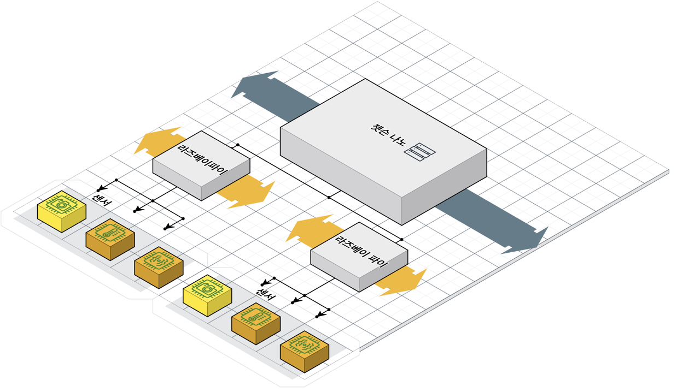
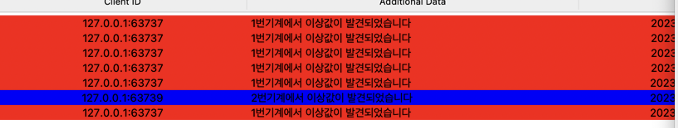
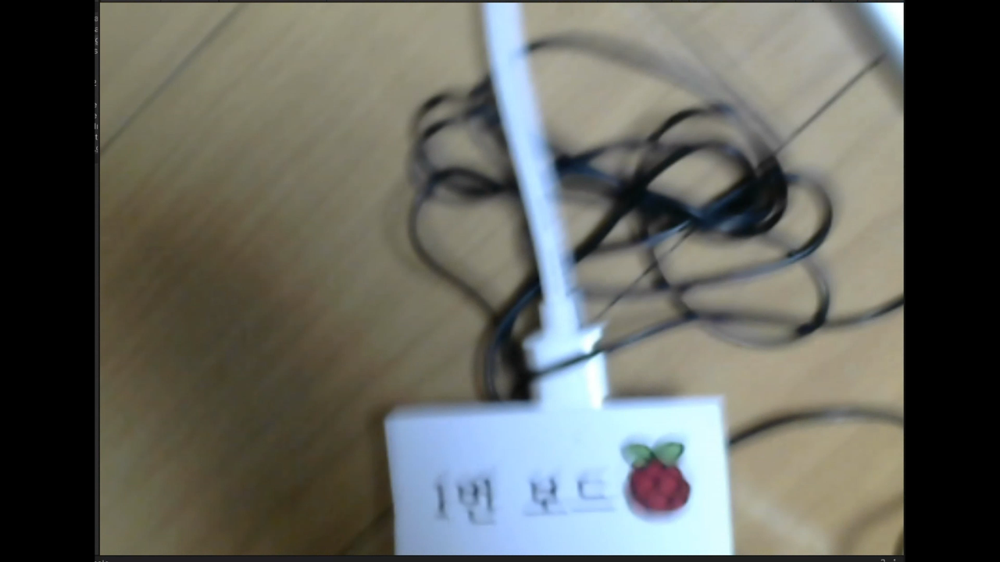
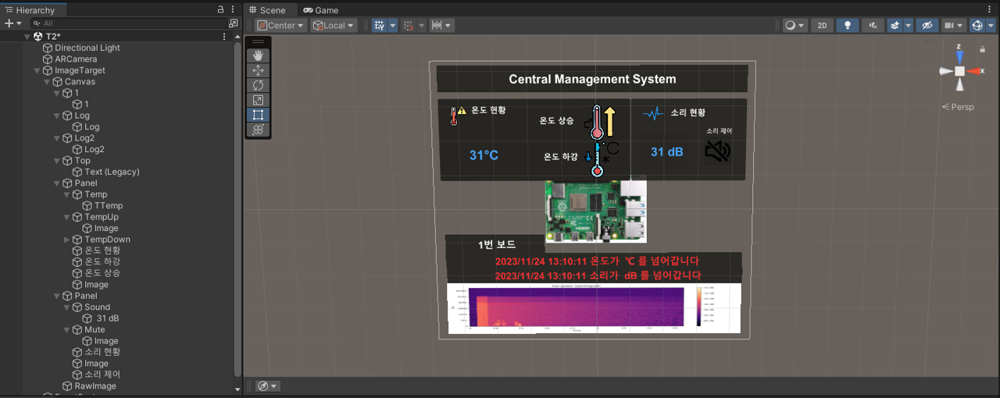

# 엣지에서 듣는 기계 이상음 | Edge Acoustic Monitor

모터 옆의 Raspberry Pi가 마이크 소리를 분석하고, 큰 진폭이 반복되면 Jetson Nano에 경보를 보낸다. 운영자는 중앙 화면에서 어느 장치가 언제 경보를 보냈는지 확인하고 웹캠으로 현장을 살펴볼 수 있다. **Plan T · 김주형, 홍성민**의 IoT 텀 프로젝트다.

| 시연에 사용한 Jetson Nano | 센서와 보드를 연결한 시스템 구조 |
| --- | --- |
|  |  |

## 1. Raspberry Pi가 경보를 만드는 기준

마이크 입력은 16 kHz, 16비트 모노다. 아래 화면에서 첫 번째 그래프는 소리의 파형, 두 번째는 시간에 따라 어느 주파수 대역에 에너지가 집중되는지 보여주는 멜 스펙트로그램이다. 세 번째 그래프의 빨간 표식은 진폭 기준을 넘긴 샘플이다.


코드는 최근 10,240개 샘플(약 0.64초)에서 절대 진폭이 5,000을 넘는 샘플을 센다. 1,000개 이상이고 영상 송신 스레드가 동작 중이면 경보 플래그를 켜고 웹캠 프레임에 경보 문구를 붙인다. 멜 스펙트로그램은 사람이 소리를 살펴보는 시각화에 쓰인다. 이 기준으로 검출할 수 있는 것은 큰 소리가 지속된 구간이며, 실제 고장 유형별 정확도는 측정 자료가 없다.

## 2. Jetson Nano에서 현장 확인

서버는 영상과 경보를 TCP 8089에서, 온도 메시지를 TCP 8090에서 받는다. Tkinter 화면은 연결별 영상을 띄우고, 경보가 담긴 프레임을 받을 때마다 접속 식별자와 수신 시각을 표에 기록한다. 경보가 이어지면 같은 장치의 기록이 여러 줄 쌓일 수 있다.

| 중앙 서버의 대기 화면 | 시연 중 쌓인 경보 기록 |
| --- | --- |
|  |  |

발표에서 제안한 온도 센서는 DHT11이다. 보관된 Python 클라이언트는 온도 채널 시연용으로 18~30 사이의 난수를 초당 한 번 전송한다. 엣지 화면 맨 아래 그래프는 별도 CSV의 `AccX` 열을 재생한다.

## 3. 현장에서 보는 Unity AR 화면

1번 보드의 표식을 Vuforia Image Target으로 등록해 휴대폰에서 해당 보드의 상태 화면을 볼 수 있도록 구성했다. 아래는 발표에 사용한 실제 표식과 Unity 편집 화면이다.

| 시연 장치의 표식 | Unity에서 배치한 상태 패널 |
| --- | --- |
|  |  |

`Temp.cs`는 온도와 음량 예시값을 생성한다. `SeverUnity.cs`는 별도 TCP 포트 8080에서 숫자 한 개를 읽어 두 표시값에 대입한다. 온도 조절·음소거 버튼은 클릭을 로그에 기록한다. 보관된 Python 송신기는 중앙 서버용으로, 이 Unity 포트에 값을 보내는 코드는 포함되어 있지 않다.

## 소스와 재현 범위

| 파일 | 살펴볼 부분 |
| --- | --- |
| [micro_Stream.py](edge/micro_Stream.py) | 마이크 콜백과 오디오 청크 큐 |
| [mel_spec_err.py](edge/mel_spec_err.py) | 멜 변환, 진폭 기준, 경보와 영상 송신 |
| [test_server2.py](server/test_server2.py) | 클라이언트별 영상 표시와 경보 기록 |
| [Unity 스크립트](unity/Assets) | AR 패널의 데이터 표시와 버튼 이벤트 |

발표 당시 Python 버전은 3.9.13이었다. 중앙 화면은 Tk가 설치된 데스크톱에서 다음과 같이 열고 **Start Server**를 누른다.

```bash
python -m pip install numpy pandas matplotlib pillow opencv-python
python server/test_server2.py
```

엣지 쪽에는 추가로 PyAudio, PortAudio, librosa, six, 마이크와 웹캠이 필요하다. 원본의 CSV는 제출물에 없어 같은 입력으로 전체 시연을 재현하려면 작업 디렉터리의 `datasets/test.csv`에 숫자형 `AccX` 열을 준비해야 한다. 송신 주소 두 곳과 서버의 수신 주소 두 곳도 같은 실험 환경에 맞춰야 한다. 영상 전송은 Python pickle과 네이티브 길이 형식을 사용하므로 양쪽 길이 형식이 호환되는 신뢰된 격리 실험망에서만 사용한다.

그림은 팀 최종 발표자료 22·31·34·36·39~41쪽에서 발췌했다. 저장소에는 원본 Python 파일과 Unity 패키지에서 추출한 팀 스크립트를 수록했다. Unity 씬과 Vuforia 에셋이 포함된 전체 패키지, 발표 원본 및 발표 영상은 별도 원본 자료다.
