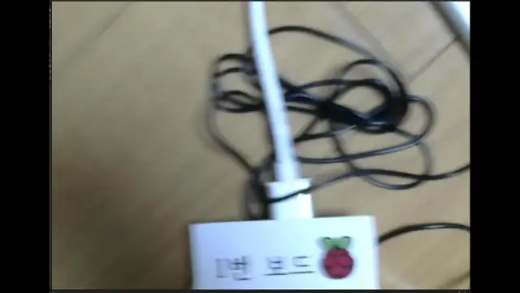
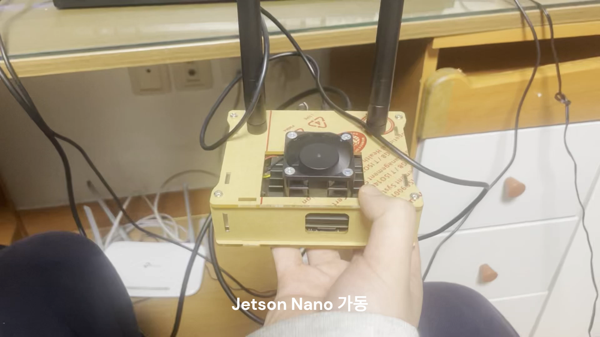
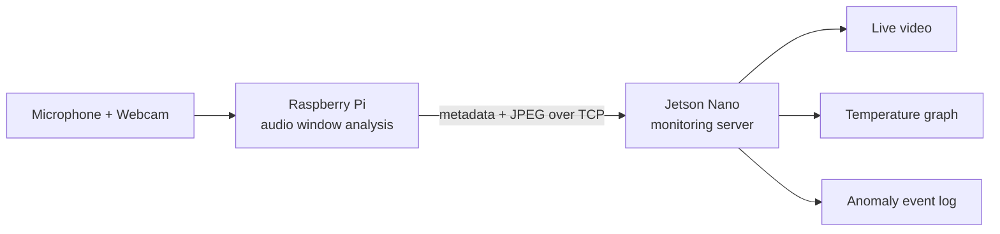
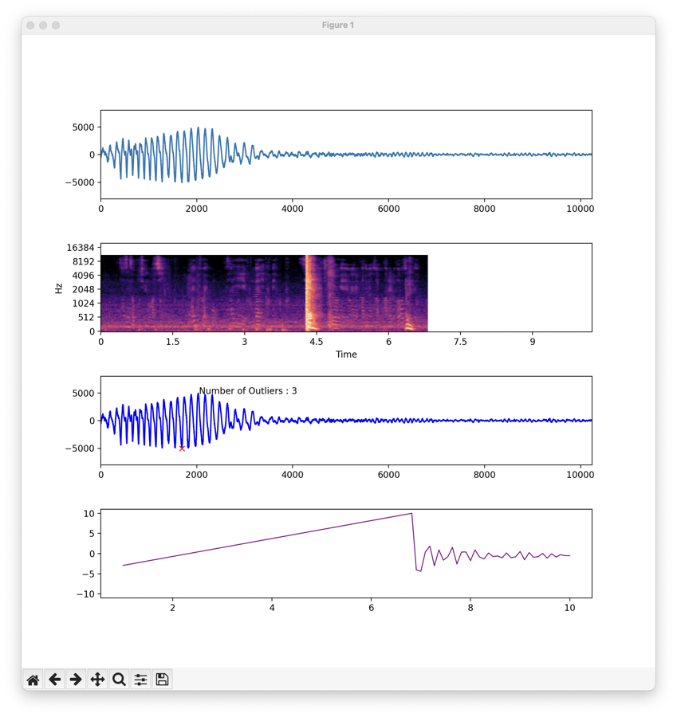
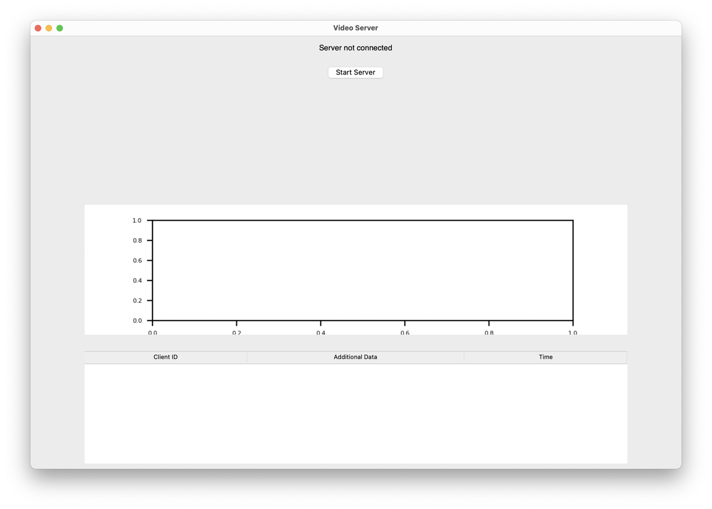

# Edge Acoustic Monitor · Unity AR 현장 모니터링

> 휴대폰 카메라로 1번 보드의 표식을 비추면, 보드 위에 온도·소리 상태와 경보 기록이 나타난다.

[](https://www.python.org/)
[](https://github.com/DoubleDeep-ai/edge-acoustic-monitor/actions/workflows/ci.yml)



*팀 최종 발표자료 39쪽에 담긴 약 7초의 실제 AR 시연. 화면의 수치는 UI 시연용이다.*

현장에서는 Unity와 Vuforia가 카메라 영상 속 보드 표식을 찾아 그 위치에 상태 패널을 겹쳐 그린다. 중앙 모니터링에서는 Raspberry Pi가 마이크 신호를 분석하고 Jetson Nano가 장치별 영상과 경보 시각을 모아 보여준다.

**IoT Term Project · Team Plan T · 김주형, 홍성민**

## 보드 표식에서 AR 화면까지

Vuforia의 **Image Target**으로 ‘1번 보드’ 표식을 등록하고, Unity에서 그 표식을 기준으로 상태 패널을 배치했다. 영상에서 카메라가 뒤로 물러나면 패널도 보드에 맞춰 작아진다. 작업자는 화면 속 수치가 어느 장치를 가리키는지 표식과 함께 확인할 수 있다.

| 카메라가 인식하는 1번 보드 표식 | Unity에서 배치한 상태 패널 |
| --- | --- |
|  |  |

[Temp.cs](unity/Assets/Temp.cs)는 예시 온도와 음량을 생성해 표시하고, [ServerUnity.cs](unity/Assets/ServerUnity.cs)는 별도 TCP 입력을 화면에 표시한다. 아래 Python 데모의 송신 대상은 Jetson Nano 대시보드다. AR 앱을 다시 빌드하려면 공개본의 C# 스크립트 외에 원본 Unity 씬과 Vuforia 설정이 필요하다.

## 엣지 장치와 중앙 대시보드

| 실제 시연 장치 | 전체 시스템 구조 |
| --- | --- |
|  |  |

## System overview



1. 마이크 입력을 16 kHz, 16-bit mono로 수집한다.
2. 최근 0.64초 구간에서 절대 진폭이 임계값을 넘은 샘플 수를 계산한다.
3. 판정할 때마다 경보 상태, 시연용 온도값, JPEG 프레임을 하나의 TCP 패킷으로 전송한다.
4. 중앙 대시보드는 네트워크 작업과 GUI 갱신을 분리해 영상·그래프·이벤트를 표시한다.

## Detection prototype



발표 시연에서는 최근 10,240개 샘플 중 `|amplitude| > 5,000`인 샘플이 1,000개 이상이면 이상 징후로 판정했다.

```text
anomaly = count(|x| > amplitude_threshold) >= exceedance_count
```

멜 스펙트로그램은 주파수 에너지 분포를 관찰하는 시각화에 사용했다. 저장된 데이터에는 정상·고장 라벨이 없어 정확도, 재현율, 고장 유형 분류 성능을 산출하지 않았다. 따라서 이 결과는 **큰 소리가 지속되는 구간을 감지하는 프로토타입**으로 해석해야 한다.

## Central monitoring

| 서버 대기 화면 | 시연 중 수집된 경보 기록 |
| --- | --- |
|  |  |

현재 코드는 원본 시연의 주요 동작을 보존하면서 다음 부분을 정리했다.

- 서버가 외부 장치의 연결을 받을 수 있도록 기본 바인딩 주소를 `0.0.0.0`으로 변경
- 네트워크 수신 스레드와 Tkinter 갱신을 큐로 분리
- Python `pickle` 대신 JSON 메타데이터와 JPEG 바이트로 구성된 길이 지정 패킷 사용
- 연결 종료, 잘린 패킷, 카메라 읽기 실패 처리
- 오디오 버퍼를 최근 분석 구간으로 제한
- 하드웨어 없이 전체 흐름을 확인할 수 있는 시뮬레이션 모드 제공

## Quick start

Python 3.9 이상이 설치된 PC 한 대에서 시뮬레이션할 수 있다.

```bash
git clone https://github.com/DoubleDeep-ai/edge-acoustic-monitor.git
cd edge-acoustic-monitor

python -m venv .venv
# Windows: .venv\Scripts\activate
# macOS/Linux: source .venv/bin/activate
python -m pip install -r requirements.txt
```

첫 번째 터미널에서 중앙 대시보드를 실행한다.

```bash
python -m server.test_server2
```

두 번째 터미널에서 가상 엣지 노드를 실행한다. 정상 구간과 이상 구간이 주기적으로 바뀌며, 웹캠이 없어도 합성 화면이 전송된다.

```bash
python -m edge.mel_spec_err --simulate --host 127.0.0.1
```

## Raspberry Pi and Jetson Nano

Jetson Nano에서 서버를 실행한 뒤 Raspberry Pi에 Jetson Nano의 LAN 주소를 전달한다.

```bash
# Jetson Nano
python -m server.test_server2 --host 0.0.0.0 --port 8089

# Raspberry Pi
python -m pip install -r requirements-edge.txt
python -m edge.mel_spec_err --host 192.168.0.107 --port 8089 --camera 0
```

`192.168.0.107`은 발표 당시 예시 주소다. 실제 Jetson Nano 주소로 바꿔야 한다. PyAudio 설치 전 Debian 계열 환경에서는 `portaudio19-dev`가 필요할 수 있다.

주요 옵션은 다음 명령으로 확인할 수 있다.

```bash
python -m edge.mel_spec_err --help
python -m server.test_server2 --help
```

## Repository structure

```text
edge-acoustic-monitor/
├── common/protocol.py          # JSON + JPEG TCP framing
├── edge/
│   ├── mel_spec_err.py         # audio analysis and edge client
│   └── micro_Stream.py         # PyAudio callback stream
├── server/test_server2.py      # multi-client Tkinter dashboard
├── unity/Assets/               # Unity UI prototype scripts
├── tests/test_protocol.py      # packet framing tests
├── docs/images/                # presentation figures
└── requirements*.txt
```

## Scope and limitations

- 진폭 기반 규칙은 주변 소음과 마이크 이득에 민감하므로 실제 설비에 적용하려면 현장별 임계값 보정이 필요하다.
- 온도는 원본 시연과 현재 데모 모두 합성값이다. DHT11 연결 시 `read_temperature()`를 실제 센서 함수로 교체해야 한다.
- 네트워크 암호화와 사용자 인증은 구현하지 않았다. 신뢰할 수 있는 실험용 LAN에서 사용하도록 설계했다.
- 경보는 고장 진단 결과가 아니라 추가 점검이 필요한 큰 소리 구간을 의미한다.

발표자료의 시스템 구조, 실제 장치, 분석 화면, 중앙 대시보드 및 AR 화면을 문서화에 사용했다. 저장소에는 팀이 제출한 Python 소스와 Unity 패키지에서 추출한 C# 스크립트를 정리해 수록했다.
